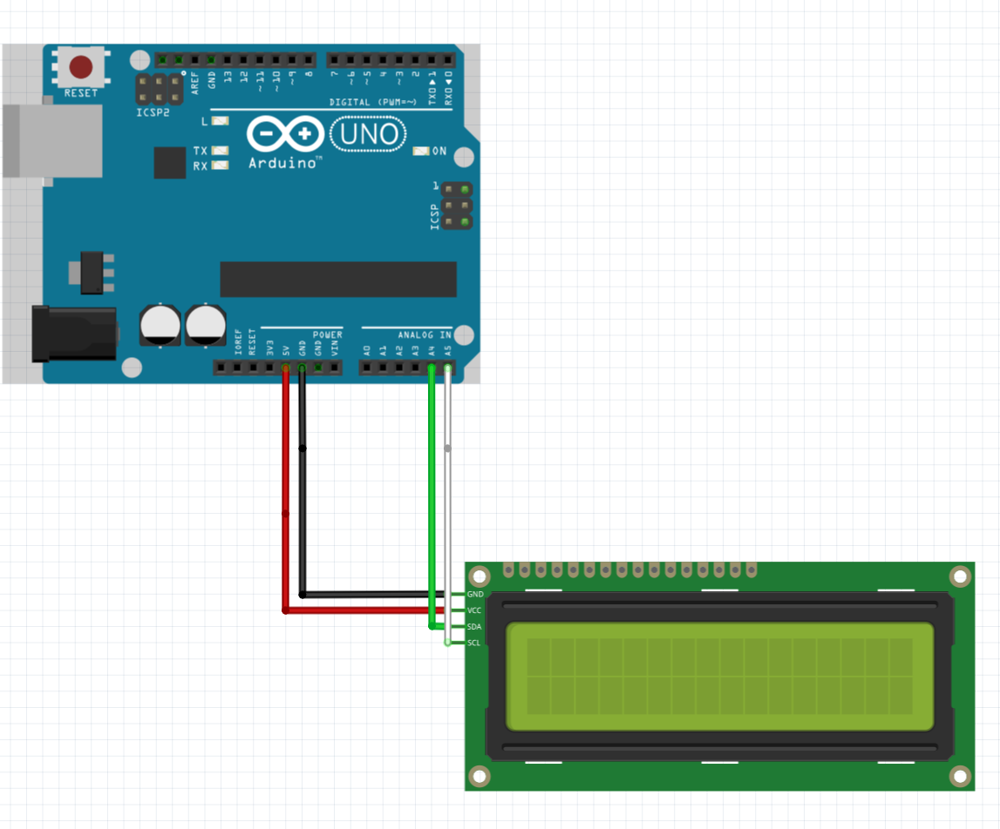

# Arduino-LCD-Cat
# 🐈 Arduino LCD 고양이 애니메이션

## 1. 프로젝트 소개

본 프로젝트는 Arduino UNO와 16×2 I2C LCD를 이용하여 걷는 고양이 애니메이션을 구현한 프로젝트이다.

LCD의 사용자 정의 문자(Custom Character) 기능을 활용하여 고양이의 모습을 직접 설계하였으며, 여러 개의 프레임을 순차적으로 변경하여 고양이가 걷는 것처럼 표현하였다.

고양이는 LCD 첫 번째 줄의 첫 번째 칸부터 두 개의 문자 칸을 사용하여 표시되며, 다리 움직임과 꼬리의 흔들림, 몸통의 미세한 상하 움직임을 통해 자연스러운 걷기 동작을 구현하였다.

본 프로젝트의 목적은 I2C LCD의 동작 원리를 이해하고, 사용자 정의 문자와 시간 제어 함수를 활용하여 간단한 애니메이션을 구현하는 것이다.

## 2. 사용 부품

- Arduino UNO
- 16×2 I2C LCD (LCD1602)
- 점퍼선

## 3. 회로 연결

Arduino UNO와 I2C LCD를 점퍼선 4개로 직접 연결하였다.

| Arduino UNO | I2C LCD |
|---|---|
| GND | GND |
| 5V | VCC |
| A4 | SDA |
| A5 | SCL |

### Fritzing 연결도

## 4. 주요 구현 기능

### 4.1 사용자 정의 문자 생성

`lcd.createChar()` 함수를 사용하여 LCD의 5×8 픽셀을 직접 설정하였다.

고양이의 모습을 두 개의 사용자 정의 문자로 나누어 표현하고, 이를 나란히 배치하여 하나의 고양이 형태를 완성하였다.

### 4.2 걷기 애니메이션 구현

총 8개의 프레임을 제작하여 고양이의 걷기 동작을 구현하였다.

프레임마다 다리의 위치와 꼬리 모양을 변경하였으며, 일부 프레임에서는 몸통의 높이를 조절하여 자연스러운 움직임을 표현하였다.

### 4.3 애니메이션 시간 제어

`millis()` 함수를 이용하여 일정한 시간 간격으로 프레임을 변경하였다.

`delay()` 함수 대신 `millis()`를 사용하여 프로그램의 실행을 불필요하게 멈추지 않고 애니메이션이 반복되도록 구현하였다.

### 4.4 LCD 출력

`lcd.setCursor()` 함수를 이용하여 LCD 첫 번째 줄의 첫 번째 위치를 지정하였다.

`lcd.write()` 함수로 사용자 정의 문자를 출력한 후, `lcd.createChar()`를 이용하여 문자 패턴을 갱신하는 방식으로 고양이가 같은 위치에서 계속 걷도록 구현하였다.

## 5. 실행 결과

Arduino에 프로그램을 업로드하면 LCD 첫 번째 줄의 왼쪽에 고양이가 나타난다.

고양이는 제자리에서 다리를 움직이고 꼬리를 흔들며, 몸통이 미세하게 위아래로 움직이는 걷기 애니메이션을 반복한다.

### 실행 영상

[▶ 고양이 애니메이션 실행 영상 보기](Arduino_LCD_Cat_Demo.mp4)

## 6. 제작 과정 및 고찰

처음에는 LCD의 제한된 픽셀 수로 고양이의 모습을 표현하는 데 어려움이 있었다. LCD의 사용자 정의 문자는 하나당 5×8 픽셀로 구성되기 때문에, 하나의 문자만으로는 고양이의 몸통과 다리를 자세히 표현하기 어려웠다.

이를 해결하기 위해 두 개의 문자 칸을 연결하여 고양이의 전체 모습을 설계하였다.

또한 단순히 다리의 위치만 변경하면 움직임이 부자연스러워 보이는 문제가 있었다. 이를 개선하기 위해 꼬리의 움직임과 몸통의 미세한 상하 움직임을 추가하고, 프레임 전환 속도를 조절하였다.

애니메이션 구현 과정에서는 `millis()` 함수를 활용하여 일정한 간격으로 사용자 정의 문자 패턴을 변경하는 방법을 학습하였다.

이번 프로젝트를 통해 I2C 통신을 이용한 LCD 제어 방법과 사용자 정의 문자의 활용 방법을 이해할 수 있었으며, 제한된 픽셀 환경에서도 여러 프레임을 활용하면 다양한 움직임을 표현할 수 있다는 것을 확인하였다.
